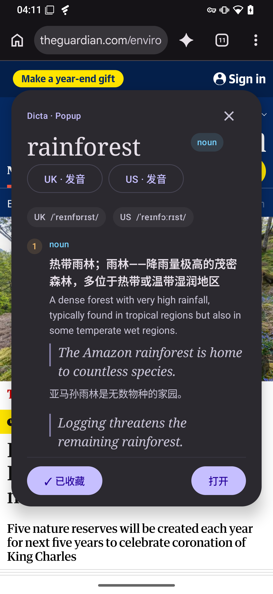
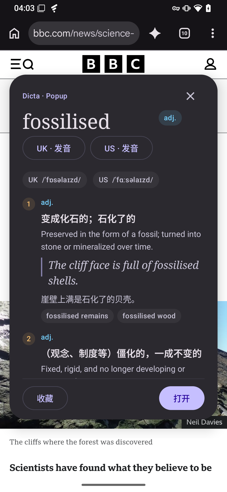
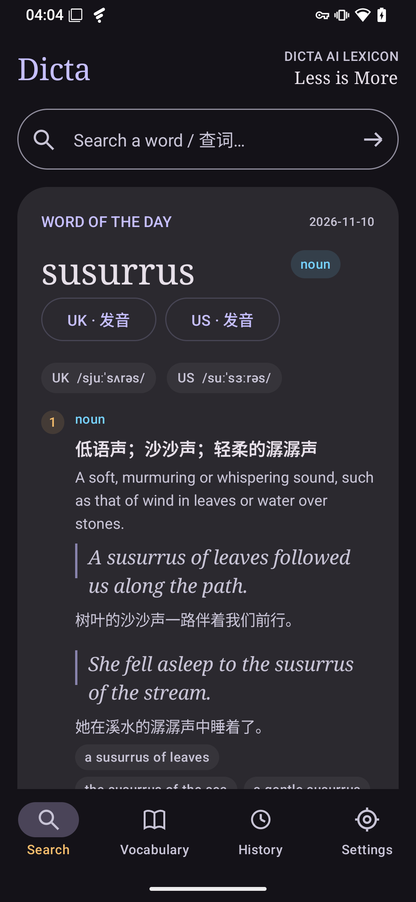
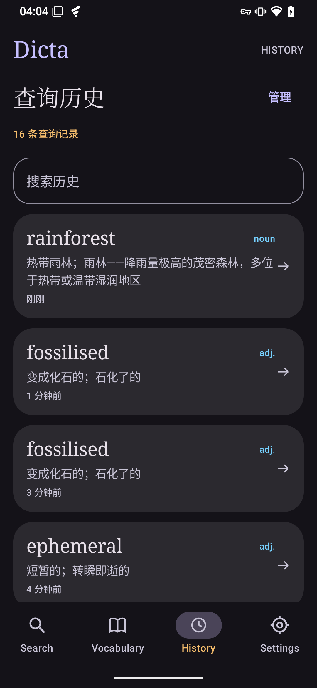
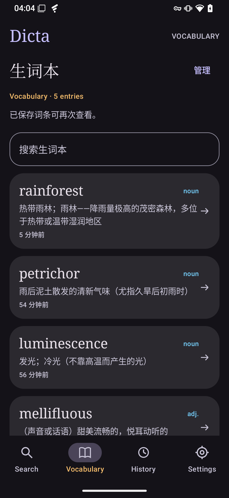
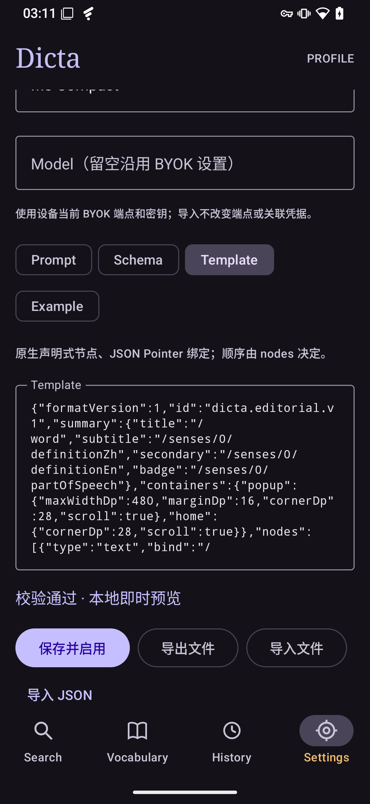

[English](README.md) · [简体中文](README.zh-CN.md)

  

<h1 align="center">Dicta</h1>

<strong>Meet a word. Keep your place.</strong>

An AI dictionary for Android, built around the way you read.

  <a href="https://github.com/rando1ph/dicta/releases/latest">Download for Android</a> ·
  <a href="#make-it-your-dictionary">Bring your own API key</a> ·
  <a href="LICENSE">Apache-2.0</a>

  
  

## A closer look, without losing the thread

An unfamiliar word should be a small detour. Select it in Chrome or another app that supports Android's text selection actions, choose **Dicta**, and explore a clear, readable entry in a native popup. Listen, save the word, then return to your reading.

Prefer to start with a question? Open Dicta and look up a word from Home. The default profile brings together English and Chinese definitions, examples, pronunciation, and word origins in one place.

## From a quick lookup to a lasting vocabulary

- **Look up words where you find them.** A focused popup keeps your reading visible. Open the full entry whenever you want more room.
- **Pick up where you left off.** Open a dedicated word detail page from Search, History or Vocabulary, then return to your previous input, filters and scroll position. Saved entries reopen locally, without another AI request.
- **Keep the words that matter.** Build your own Vocabulary with a tap. Removing a history item leaves a bookmarked entry available.
- **Find a little inspiration.** Home automatically fetches a Word of the Day when no matching daily cache is available. Revisit the cached word or ask for another using your configured provider; new generations use your provider's API allowance.
- **Hear the difference.** Play UK or US pronunciation with Android text-to-speech (TTS), wherever your installed speech engine provides those voices.
- **Make yourself at home.** Choose a light or dark theme and your preferred accent colour.

<table>
  <tr>
    <th>Home &amp; Word of the Day</th>
    <th>History</th>
    <th>Vocabulary</th>
  </tr>
  <tr>
    <td></td>
    <td></td>
    <td></td>
  </tr>
</table>

## Make it your dictionary

**Your provider. Your API key.** Dicta uses BYOK: choose DeepSeek, OpenAI or a compatible HTTPS Chat Completions endpoint in Settings, then supply your own key. Fetch and search the provider's model list, or enter a Model ID manually. Choose JSON mode or prompt-only JSON output; responses still pass the Profile's schema validation. Compatibility depends on the endpoint and model. AI service access and any usage charges come from your provider. Dicta does not include an API key or AI credit.

Your key is encrypted on the device using Android Keystore. Changing the service host or port requires a new key; editing the model or API path on the same service can retain the saved key. A Profile's nonempty model setting takes priority over the global model. New lookups send the selected or typed word and your profile instructions to your chosen provider; saved entries can be reopened locally. Pronunciation uses your Android speech engine, separately from the text model.

**Start with a complete profile. Shape it as you learn.** The built-in Profile is ready once your API is configured. For more control, copy it and edit the Prompt, Schema, and Template to decide what an entry explains and how it appears. Validate and preview your changes, switch profiles, or import and export them. Previously saved entries retain their original presentation.

  

## Get Dicta

1. Download **Dicta-v1.1.0.apk** from [GitHub Releases](https://github.com/rando1ph/dicta/releases/latest) and install it. Android may ask you to allow installation from the app you used to download it.
2. Open **Settings** and save your provider's endpoint, model, and API key.
3. Search from Home, or select a word in a supported app and choose **Dicta** from the selection menu (sometimes under **More**).

Requires **Android 8.0 or later**. Version **1.1.0** adds dedicated word details, broader BYOK settings and improved layouts for narrow screens and large fonts. See the [release notes](docs/releases/v1.1.0/Release-Notes.en.md). The current interface is primarily Simplified Chinese, with bilingual English–Chinese entries in the default profile. Selection actions and available TTS voices depend on the host app and device.

The public app uses `dev.randolf.dicta`. Version 1.1.0 uses the same release signing certificate as 1.0.0 and can be installed as an update. Earlier prototype builds install separately; their data and API settings stay in the prototype app.

## Open source

Copyright © 2026 **rando1ph**. Dicta's original code is licensed under the [Apache License 2.0](LICENSE). See [third-party notices](THIRD_PARTY_NOTICES.md) for dependencies and asset attribution, and [development notes](docs/DEVELOPMENT.md) to build from source.

Screenshots show version 1.0.0 and are unmodified captures from a real device. BBC and The Guardian names, marks, articles, and photographs belong to their respective owners and appear only as browsing context; no affiliation or endorsement is implied.
