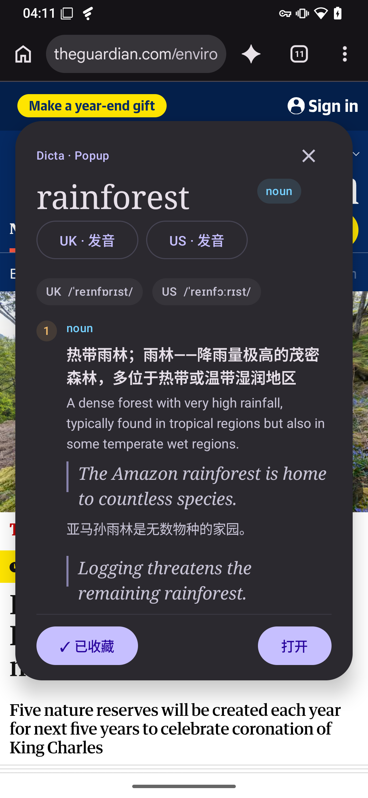
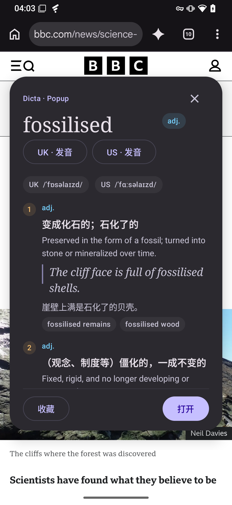
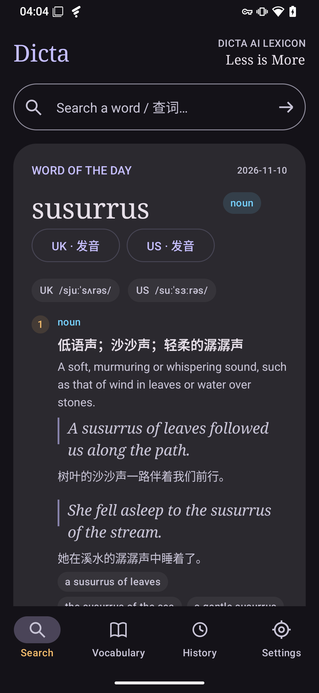
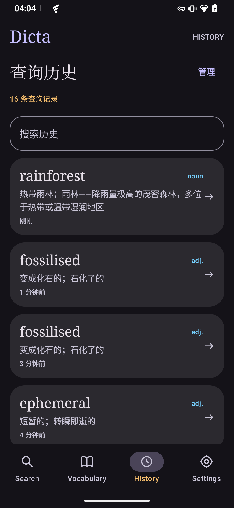
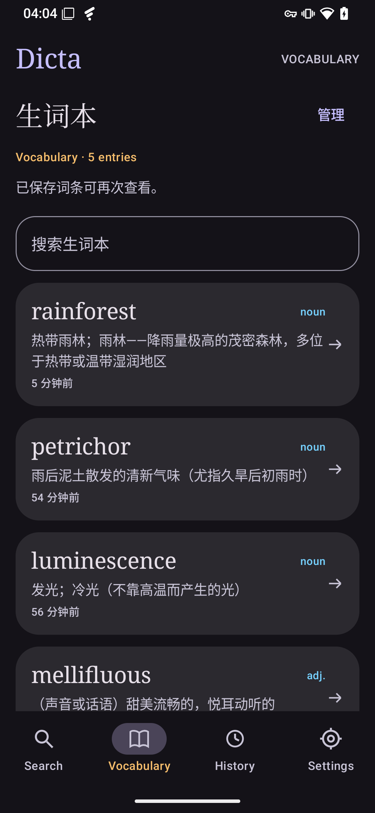
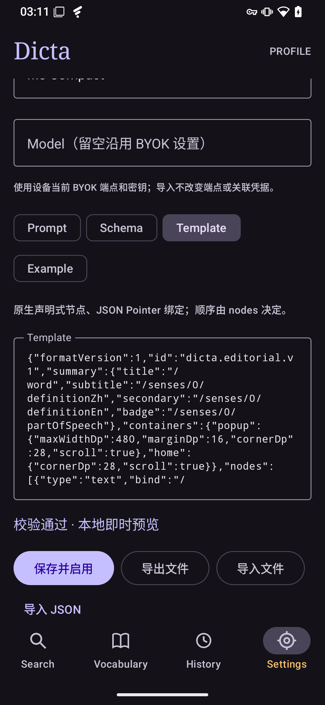

[English](README.md) · [简体中文](README.zh-CN.md)

  

<h1 align="center">Dicta</h1>

<strong>读到生词，随手读懂。</strong>

为 Android 阅读体验而生的 AI 词典。

  <a href="https://github.com/rando1ph/dicta/releases/latest">下载 Android 版</a> ·
  <a href="#让词典适合你">使用自己的 API Key</a> ·
  <a href="LICENSE">Apache-2.0</a>

  
  

## 查清一个词，接着读下去

遇到不认识的单词，不必打断阅读。在 Chrome 或其他支持 Android 文字选择操作的应用中选中单词，点击 **Dicta**，即可在原生弹窗里查看释义、听发音、收藏词条。关闭弹窗，继续刚才的阅读。

也可以直接打开 Dicta，从首页主动查词。默认配置将中英释义、例句、音标和文字词源整合在同一份清晰的词条中。

## 从一次查词，到自己的生词本

- **划词即查。** 居中弹窗保留原应用的阅读背景，需要时可打开完整词条。
- **查过的词，随时重温。** 历史记录支持搜索与管理，已保存词条可在本地再次打开，无须重复请求 AI。
- **值得记住，就收藏。** 一键加入 Vocabulary 生词本；删除历史记录后，已收藏的词条仍可保留。
- **每天认识一个词。** 首页展示每日单词，也可以用已配置的 AI 服务「换一换」。
- **听听英美发音。** 通过 Android 系统文字转语音（TTS）播放 UK / US 发音，具体可用口音取决于设备安装的语音引擎。
- **选你喜欢的样子。** 支持浅色、深色主题与强调色切换。

<table>
  <tr>
    <th>首页与每日单词</th>
    <th>查询历史</th>
    <th>生词本</th>
  </tr>
  <tr>
    <td></td>
    <td></td>
    <td></td>
  </tr>
</table>

## 让词典适合你

**自己的服务，自己的 API Key。** Dicta 采用 BYOK：在设置中填写自己的 HTTPS 服务地址、模型和密钥。DeepSeek 已完成实测；其他端点需要兼容相同的聊天补全请求与 JSON 输出格式，兼容性因服务而异。AI 服务及其用量费用由你选择的供应商提供和收取，Dicta 不附赠 API Key 或 AI 额度。

密钥通过 Android Keystore 在设备上加密保存。新查询会将所选或输入的单词以及 Profile 指令发送给你配置的服务；已保存的词条可以本地重看。发音独立使用 Android 语音引擎，无须额外配置文本模型的语音接口。

**先用默认配置，再打造自己的词典。** 配好 API 后，即可使用完整的内置 Profile。想调整释义内容和展示方式时，可以复制并编辑 Prompt、Schema 和 Template，校验后即时预览，或切换、导入和导出配置。过去保存的词条保留当时的展示方式。

  

## 开始使用

1. 前往 [GitHub Releases](https://github.com/rando1ph/dicta/releases/latest) 下载 **Dicta-v1.0.0.apk** 并安装。Android 可能提示允许下载来源应用安装 APK。
2. 打开 **Settings / 设置**，保存服务地址、模型和 API Key。
3. 回到首页查词，或在支持的应用里选中单词，再从选择菜单中点击 **Dicta**（部分应用需先打开「更多」）。

需要 **Android 8.0 及以上版本**。**1.0.0** 是首个公开正式版本，已在运行 Android 15 的 OnePlus 6T 上测试。当前界面以简体中文为主，默认词条包含中英双语释义。划词入口和 TTS 口音的可用性取决于宿主应用及设备。

正式应用包名为 `dev.randolf.dicta`。此前的原型测试包可独立共存，原数据和 API 配置仍保存在测试包中。

## 开源与许可

Copyright © 2026 **rando1ph**。Dicta 原创代码采用 [Apache License 2.0](LICENSE)。依赖与素材归属见[第三方声明](THIRD_PARTY_NOTICES.md)，源码构建方法见[开发说明](docs/DEVELOPMENT.md)。

截图为真实设备的未经修改原图。BBC、The Guardian 的名称、商标、文章与照片归各自权利人所有，仅作为实际浏览场景展示，不代表双方存在合作或背书关系。
